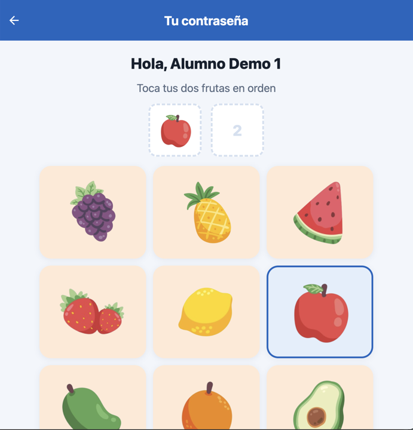
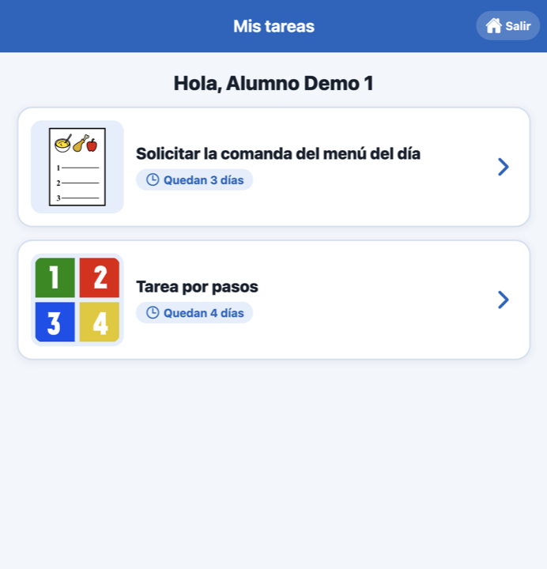
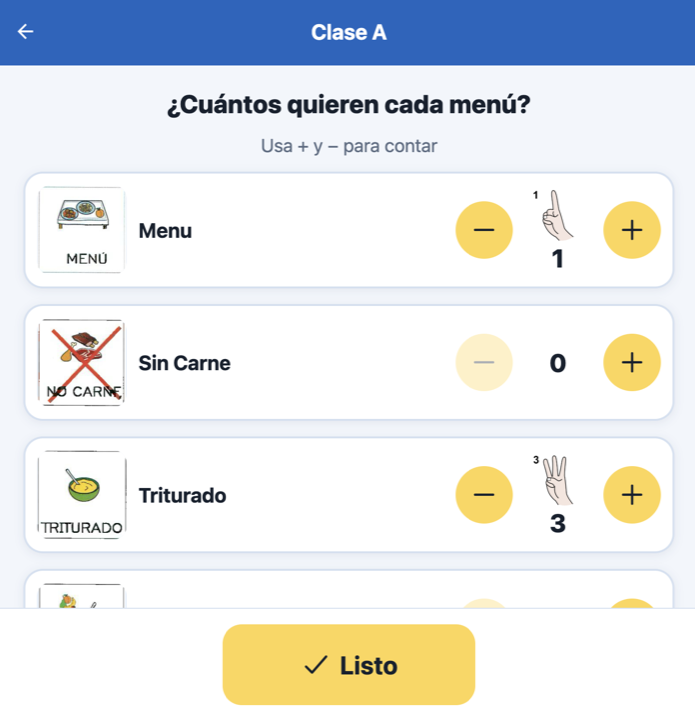
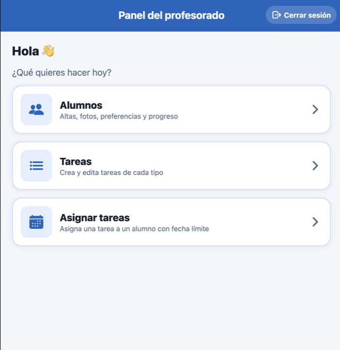

# SyncMind · Pictogram Task App

A React Native (Expo) app for a special-education school: teachers create and assign daily tasks, and students complete them on a tablet through a pictogram-based, accessible interface.


## Screenshots

| Student login | Student tasks | Menu task | Teacher panel |
|---|---|---|---|
|  |  |  |  |

## Features

- **Pictogram login for students**: each student picks their photo and enters a two-fruit visual password, with clear feedback when it is wrong.
- **Four task types**: step-by-step activities, collecting school materials, photocopies/laminating, and taking the daily lunch-menu order from each classroom with finger-count pictograms.
- **Per-student display mode**: every task can be shown with ARASAAC pictograms, real photos or plain text, depending on each student's needs.
- **Teacher dashboard**: create and edit students and tasks, assign a task to several students with a due date, and track completed tasks against the class average.
- **Runs locally in one command**: `npm run demo` starts a Firestore emulator with seeded demo data, so the app can be tried without any credentials.

## Tech stack

| Technology | Used for |
|---|---|
| React Native 0.76 + Expo SDK 52 | Cross-platform app (tablet first; also runs on the web) |
| React Navigation 6 (stack) | Navigation between student and teacher screens |
| Firebase Firestore | Students, teachers, tasks and task assignments |
| Firebase Emulator Suite | Local demo database with seeded data (`scripts/seed-emulator.mjs`) |
| Cloudinary | Uploading student avatars and step images |
| date-fns | Due dates and "days left" labels |
| ARASAAC pictograms | Visual vocabulary for students (see [NOTICE.md](NOTICE.md)) |

## Getting started

**Requirements:** macOS or Linux, Node.js 20+ (tested with 22 LTS) and Java 21 (needed by the Firestore emulator).

```bash
# macOS (Homebrew); both packages are keg-only, so add them to PATH
brew install node@22 openjdk@21
export PATH="/opt/homebrew/opt/node@22/bin:/opt/homebrew/opt/openjdk@21/bin:$PATH"

npm ci
npm run demo
```

Then open:

- App: <http://localhost:8081>
- Emulator UI (browse the data): <http://localhost:4000>

Demo accounts (local emulator only):

| Role | How to sign in |
|---|---|
| Teacher | user `demo`, password `demo` |
| Alumno Demo 1 (pictograms) | grapes, then apple |
| Alumno Demo 2 (real photos) | strawberry, then orange |
| Alumno Demo 3 (text only) | pineapple, then watermelon |

**Using your own Firebase project:** copy `.env.example` to `.env.local`, fill in your Firebase web config (and optionally your Cloudinary cloud name), then run `npm run web` or `npm start`.

> The web build is the easiest way to try the app. Native builds need Xcode or Android Studio; the current Expo Go app no longer supports SDK 52.

## Project structure

```
├── App.js                  # Entry point (centred tablet-width layout on the web)
├── navigator/              # Stack navigator and shared header options
├── screens/
│   ├── students/           # Task list and the four task screens
│   ├── teachers/           # Login, dashboard, student and task management
│   └── …                   # Home, pictogram password, reward screen
├── componentes/            # Shared UI kit, step editor, student form, "Done" button
├── services/               # Firebase config (env based) and Cloudinary uploads
├── utils/                  # Design tokens, responsive sizing, helpers
├── scripts/                # Firestore emulator seed data
└── images/                 # ARASAAC pictograms and openly licensed photos
```

## What I learned

- **Designing for accessibility first**: big touch targets, one action per screen and immediate visual feedback matter more than visual polish for students who rely on pictograms.
- **Modelling flexible data in Firestore**: each task type stores a different shape (steps, materials, class menus), and assignments live on each student with Firestore document references.
- **Making a project reproducible**: moving credentials to environment variables and adding a seeded emulator turned a project that only ran against a private Firebase account into one anyone can start with a single command.
- **Debugging cross-platform gaps**: some React Native APIs behave differently on the web (`Alert.alert` does nothing, screens did not scroll, sizes scaled with the window), so I added web-safe alternatives.

## Context & credits

Team project for the **MDA** and **DGP** courses at the **University of Granada** (2024/25), built collaboratively by a student team.

**My part:** I built the **lunch-menu task module** end to end: task creation for teachers (`taskMenu.js`), task assignment to students and classes (`taskAssignment.js`), the student menu flow with pictograms, real photos and finger counting (`UserMenuTask.js`, `AssignmentMenuClass.js`), and the navigation and home-screen work needed to integrate it.

In 2026 I refreshed the project for my portfolio with the help of Claude Code: a redesigned and responsive UI with a shared design system, bug fixes, environment-based configuration and the local Firestore demo.

**Third-party assets:**
- Pictograms by Sergio Palao, from [ARASAAC](https://arasaac.org) (Government of Aragón), licensed under [CC BY-NC-SA 4.0](https://creativecommons.org/licenses/by-nc-sa/4.0/).
- Photos from Wikimedia Commons (public domain, CC0 or CC BY); authors and licenses are listed in [NOTICE.md](NOTICE.md).

**License:** source code under the [MIT License](LICENSE); images keep their own licenses as described in [NOTICE.md](NOTICE.md).
